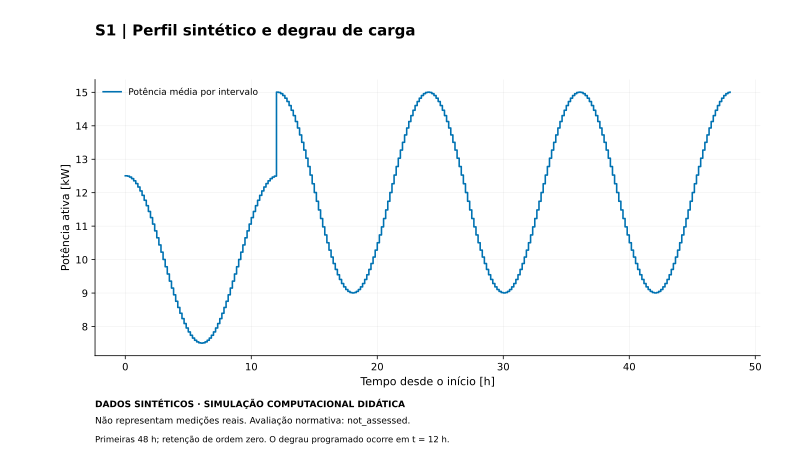
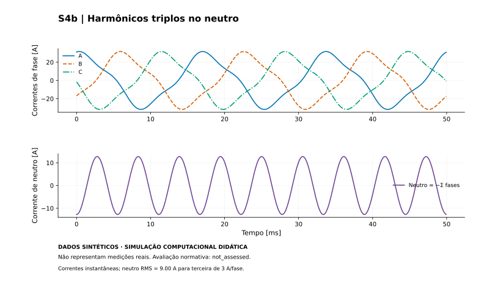
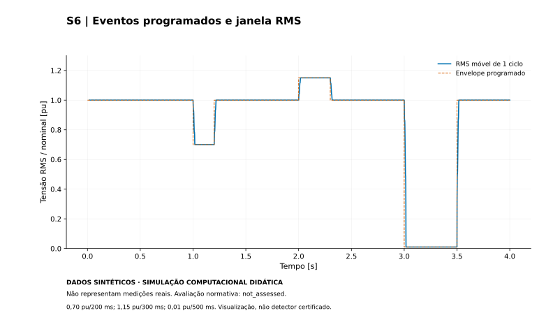

# QEE sintético — análise trifásica reproduzível

**DADOS SINTÉTICOS — SIMULAÇÃO COMPUTACIONAL DIDÁTICA — NÃO REPRESENTAM MEDIÇÕES REAIS.**

Projeto científico Python da JV Engineering para explorar qualidade da energia por modelos explícitos de tensões e correntes. Gera nove cenários, integra energia por intervalos, exporta XLSX e produz doze figuras vetoriais SVG. Não depende de arquivos de medições nem acessa a rede durante a análise.

Não é instrumento certificado, avaliação regulatória, projeto executivo, laudo ou ferramenta de dimensionamento de instalações. `normative_assessment = not_assessed` permanece obrigatório. O código autoral da nova implementação e sua documentação associada estão sob a [licença MIT](LICENSE); consulte o [escopo e os avisos de terceiros](docs/licensing.md).

**Este projeto utiliza dados sintéticos gerados por simulação computacional. Os resultados não representam medições de instalações reais e não constituem certificação de conformidade normativa.**

A implementação computacional é funcional e testada; os fenômenos elétricos são cenários simulados por modelos explícitos, sem reprodução ou validação de uma campanha real de medições.

## Conteúdo

- [Instalação e quick start](#instalação-e-quick-start)
- [Cenários e geração](#cenários-e-geração)
- [Figuras vetoriais](#figuras-vetoriais)
- [Arquitetura](#arquitetura)
- [Testes e validação](#testes-e-validação)
- [Modelo físico e limitações](#modelo-físico-e-limitações)
- [Reprodução e segurança](#reprodução-e-segurança)

## Instalação e quick start

Ambiente executado: **CPython 3.11, Windows x64**. CI configurado para Windows e Ubuntu; os resultados da execução remota devem ser conferidos nos checks do Pull Request. Outras versões de Python não são implicitamente validadas.

PowerShell, na raiz do clone QEE:

```powershell
py -3.11 -m venv .venv
.\.venv\Scripts\Activate.ps1
python -m pip install --only-binary=:all: --require-hashes -r requirements.lock
python -m pip install --no-deps --no-build-isolation -e ".[dev]"
python -m pip check
python scripts/check_lock.py

# Suite completa: 7 dias × 9 cenários, XLSX + CSV + SVG + relatório.
python -m jv_qee suite --output outputs/semana
```

Se a política local impedir ativação, use `.\.venv\Scripts\python.exe` em lugar de `python`, sem mudar a política do computador. Em Linux: `python3.11 -m venv .venv`, `source .venv/bin/activate`; os demais comandos são iguais. [Instruções offline e ambiente limpo](docs/reproduction.md).

O destino deve ser novo ou vazio. Arquivos anteriores não são sobrescritos. `COMPLETE.json` só é escrito no término; uma pasta interrompida não representa execução concluída.

## Cenários e geração

| ID | Fenômeno sintético |
|---|---|
| S0 | Fundamental equilibrada |
| S1 | Perfil artificial de carga e degrau em 12 h |
| S2 / S3 | Carga indutiva / capacitiva, sinal de Q1 |
| S4 | Harmônicos configuráveis de tensão e corrente |
| S4b | Terceira harmônica e corrente de neutro |
| S5 | Sequência negativa de tensão |
| S6 | Eventos programados: 0,70 / 1,15 / 0,01 pu |
| S7 | Frequência variável com fase analítica conhecida |
| S8 | Fixtures inválidas de teste, não um cenário de medição válido |

Defaults: 380 V linha-linha RMS, 60 Hz, 20 A/fase, fator de deslocamento 0,95 indutivo, seed 746031, N=1008, intervalos de 600 s. São escolhas didáticas independentes. [Configurações e hipóteses](docs/scenarios.md).

```powershell
python -m jv_qee generate --config configs/S4.json --output outputs/S4
python -m jv_qee generate --config configs/S1.json --n 10080 --interval-s 60 --output outputs/S1-minuto
python -m jv_qee suite --n 144 --output outputs/um-dia
python -m jv_qee validate --input outputs/semana/QEE_DADOS_SINTETICOS.xlsx
python -m jv_qee analyze --input outputs/semana/QEE_DADOS_SINTETICOS.xlsx --output outputs/reanalise
```

`generate` cria as figuras aplicáveis ao cenário; `suite` cria as doze. `--no-plots` omite somente a visualização. O Excel contém metadados, parâmetros, amostras, segmentos, cenários, eventos, fasores esparsos, dicionário, validações, indicadores e referências. O leitor rejeita fórmulas/macros/links externos e reconstrói os indicadores a partir dos fasores. Não abra a antiga planilha de terceiros para reproduzir este estudo.

## Figuras vetoriais

Figuras principais em SVG estático, sem imagens raster incorporadas. Texto convertido em contornos para fidelidade entre computadores, com `title`, `desc`, aviso sintético e dados tabulares auxiliares. [Estilo, acessibilidade e decisões de visualização](docs/graphics.md).



*S1: potência por intervalo, sem interpolação que esconda o degrau.*



*S4b: corrente de neutro obtida pela soma das correntes instantâneas; não uma medição.*



*S6: envelope programado e RMS móvel ilustrativo. Não representa detector normativo.*

As cinco candidatas para futura publicação são carga, FP, THD, neutro e eventos. As demais estão na saída reproduzível, não repetidas integralmente no README.

## Arquitetura

```text
src/jv_qee/   config, physics, scenarios, generator, aggregation, energy,
              indicators, compensation, validation, safety, io_excel,
              provenance, reporting, style, svg, plots, schema, cli
tests/        unit/, physics/, integration/, security/
configs/      nove cenários JSON independentes
docs/         metodologia, dados, testes, segurança, reprodução e SVGs
scripts/      verificação de lock, fonte e artefatos
.github/      CI somente leitura + Dependabot semanal
legacy/       referência histórica desativada, fora do pacote instalável
```

O nome `jv_qee` foi preservado para compatibilidade com a Fase 2. O CLI não importa visualização antes de precisar dela; imports não geram arquivos nem mudam estilo global. Configurações são imutáveis, com budgets explícitos de memória/entrada. Runtime sem `eval`, execução shell ou coleta de dados.

## Testes e validação

```powershell
python -m pytest -q
python -m pytest tests/unit -v
python -m pytest tests/physics -v
python -m pytest tests/integration -v
python -m pytest tests/security -v
python -m pytest --cov=jv_qee --cov-report=term-missing
python -m ruff check src tests scripts
python -m ruff format --check src tests scripts
python -m bandit -r src scripts
python -m pip_audit -r requirements.lock --disable-pip --no-deps
python scripts/source_guard.py
python scripts/verify_artifacts.py outputs/semana --evidence outputs/evidencias
```

Os 54 casos anteriores foram mantidos, com a verificação gráfica V26 adaptada a SVG principal e PNG auxiliar opcional. V30/V31 continuam explicitamente adiados: são testes da futura integração com o site, não falhas ocultadas. Há oráculos analíticos, propriedades de potência, neutralidade, energia, FFT, Excel round-trip, CLI e rejeição de entradas hostis. [Mapa V01–V32 e tolerâncias](docs/validation.md) e [organização de QA](docs/testing.md).

## Modelo físico e limitações

Fasores RMS complexos de um sistema trifásico a quatro fios, sequência ABC. `P = Σφ,h Re(Vh Ih*)`; `Q1 = Σφ Im(V1 I1*)`; `SΣ = Σφ Vrmsφ Irmsφ`; `FPΣ=P/SΣ`. Energia `ΣP Δt / 3 600 000` em kWh. THD usa a razão quadrática dos harmônicos para a fundamental; desequilíbrio usa componentes simétricas fundamentais; corrente neutra vem de `−ΣIφ,h`.

**SΣ não é a potência aparente efetiva IEEE 1459.** `P²+Q1²=SΣ²` não é identidade universal sob distorção. Q1>0 indutivo, Q1<0 capacitivo. DPF1 e FP verdadeiro não são intercambiáveis; DPF1 e FD nos intervalos são médias temporais segmentares explicitadas nos flags.

Rede/neutro ideais, excitações prescritas, sem fluxo de potência, ressonância, transientes de rede ou validação de instrumento. S7 usa fase conhecida, não estima frequência desconhecida. Compensação reativa é apenas exercício ideal restrito, sem recomendação de instalar capacitores. Nenhuma estatística antiga, multa ou economia financeira experimental é resultado deste modelo. [Equações e hipóteses completas](docs/methodology.md), [limitações normativas](docs/standards.md).

## Reprodução e segurança

Seed determinística, configurações explícitas e manifesto com hashes científicos. Igualdade numérica não exige XLSX/SVG byte a byte idênticos: containers, metadados e IDs gráficos podem variar. `jitter=0` conserva os oráculos; seeds diferentes só afetam jitter quando habilitado. N=10080 com 600 s representa 70 dias, com 60 s representa sete dias.

XLSX/JSON são entradas locais não confiáveis com limites documentados; o parser não é sandbox contra todas as formas de arquivo hostil. Saídas usam nomes fixos e escrita temporária, recusando destinos ocupados/symlinks. [Modelo de ameaças](docs/security.md), [reporte privado](SECURITY.md), [contribuições e atualizações](CONTRIBUTING.md).

A relação com a [JV Engineering](https://joaovitormiranda-eng.github.io/jv-engineering-website/) é documental. Um link no site não executa Python nem instala dependências. Os SVGs deste clone não substituem automaticamente os cinco gráficos antigos; a integração exige outro PR autorizado. [Plano de integração e controles manuais](docs/publication.md).

Referências primárias: [NumPy FFT](https://numpy.org/doc/stable/reference/routines.fft.html), [openpyxl streaming](https://openpyxl.readthedocs.io/en/stable/optimized.html), [Matplotlib e fontes](https://matplotlib.org/stable/users/explain/text/fonts.html), [portal PRODIST](https://www.gov.br/aneel/pt-br/centrais-de-conteudos/procedimentos-regulatorios/prodist). Referência não implica conformidade; o texto integral vigente do PRODIST não foi validado nesta reconstrução.
